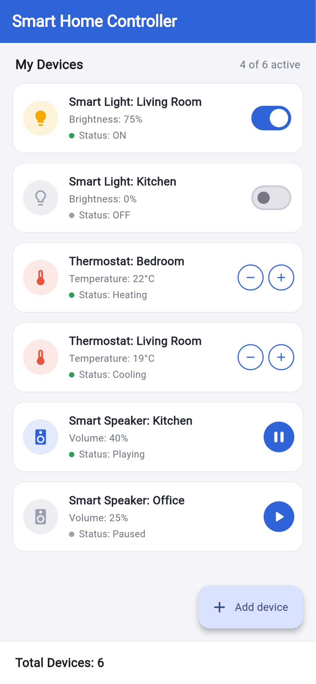
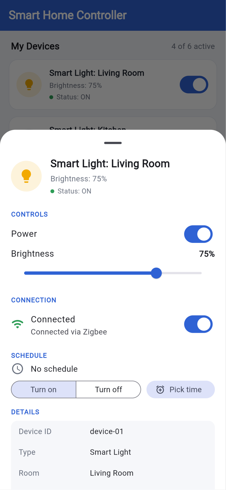
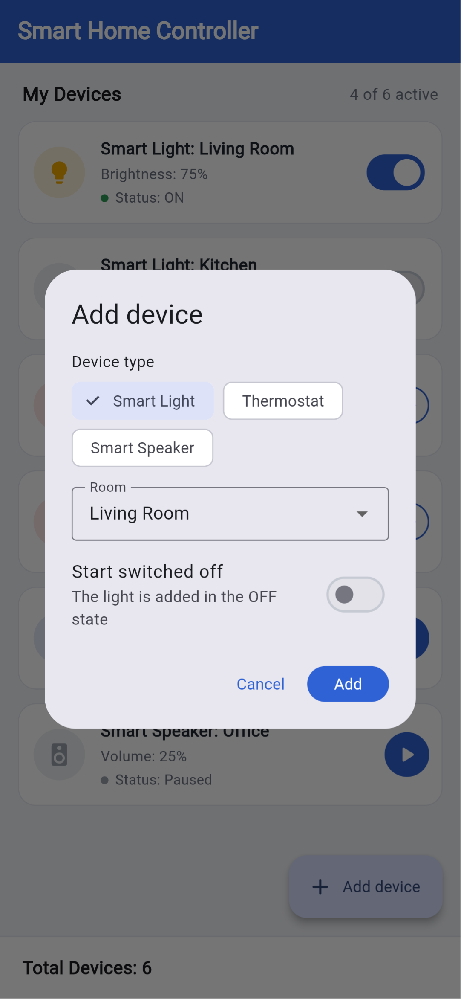
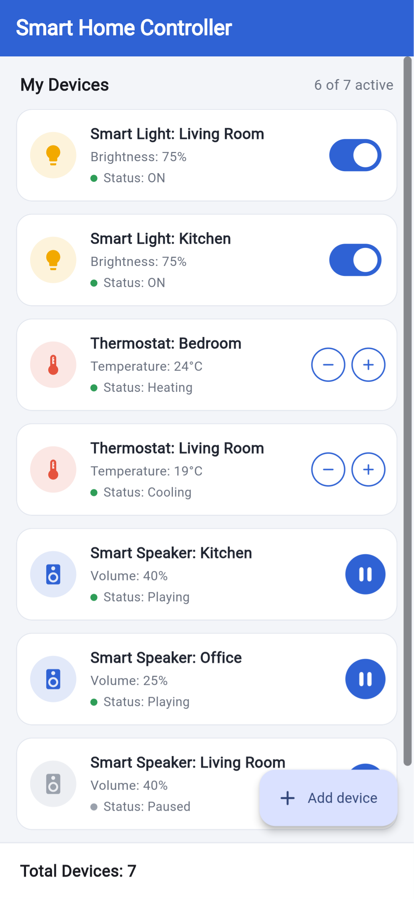
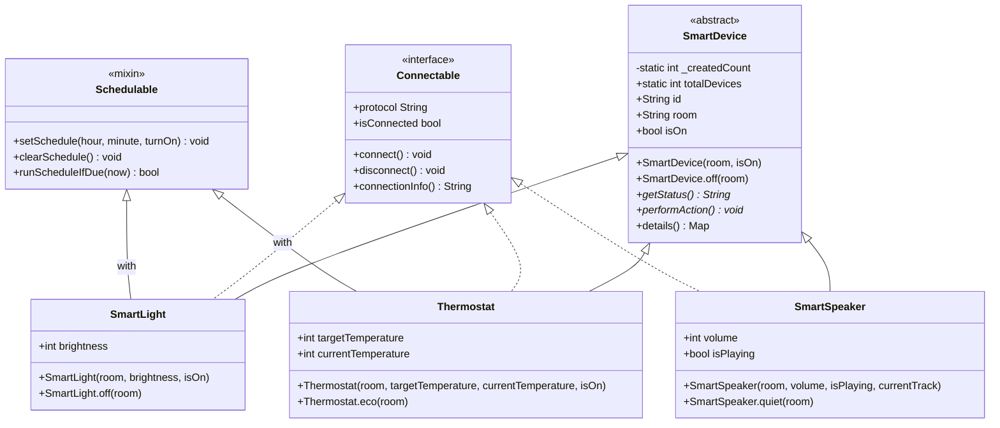

# Smart Home Controller

**BIM493 - Mobile Programming I | Assignment #2**

Smart Home Controller is a Flutter application for viewing and controlling simulated smart home devices: smart lights, thermostats and smart speakers. Every device is modelled as a Dart class built with object-oriented programming principles (abstract class, inheritance, interface, mixin, default and named constructors, `static`, `super` and `this`). The app works fully offline; no backend, login or real hardware is used.

## Team members and contributions

| Full name | Student ID | Contribution |
|---|---|---|
| Ahmet Enes Şahan | 26779932038 | `SmartDevice` abstract base class; `SmartLight`, `Thermostat` and `SmartSpeaker` subclasses; default and named constructors; static device counter; initial device data and device factory. |
| Furkan Selim Özkan | 12343613014 | `Connectable` interface and `Schedulable` mixin; device cards, details sheet and "Add device" dialog; unit and widget tests; screenshots and documentation. |

**Joint work:** class design review, emulator-based functional testing, code quality checks (`flutter analyze`) and final project review.

## Screenshots

| Device list | Device details | Add device | After interaction |
|---|---|---|---|
|  |  |  |  |

1. **Device list** – six devices created at start-up, two of each type; `Total Devices: 6` comes from the static counter.
2. **Device details** – opened by tapping a card; shows controls, connection (`Connectable`), schedule (`Schedulable`) and a details table built with `super.details()`.
3. **Add device** – creates a new object at runtime with the default or the named constructor of the chosen class.
4. **After interaction** – kitchen light switched on, bedroom thermostat raised to 24°C, office speaker playing and a new speaker added; the total is now 7.

## Features

- **Device list:** one card per device with name, main property (brightness, temperature or volume) and a coloured status line.
- **Device-specific controls:**
  - Smart Light – on/off switch (brightness slider in the details sheet)
  - Thermostat – `−` / `+` buttons to change the target temperature (16–30°C); status becomes *Heating*, *Cooling*, *Idle* or *Off*
  - Smart Speaker – play/pause button (volume slider in the details sheet)
- **Details sheet:** power, brightness/volume/temperature, connect/disconnect, daily on/off schedule and all device properties.
- **Add device:** choose type, room and start mode (light: switched off, thermostat: eco 19°C, speaker: quiet 25%).
- **Connection simulation:** a disconnected device shows *Offline*, gets a red badge and its controls are disabled.
- **Schedules:** lights and thermostats can be scheduled to turn on or off at a chosen time; the app checks schedules every 30 seconds while it is open.
- **Bottom text:** `Total Devices: N`, read directly from the static variable `SmartDevice.totalDevices`.

## How the required concepts are implemented

| Concept | Where | Implementation |
|---|---|---|
| Class | `lib/models/` | Base class `SmartDevice` and subclasses `SmartLight`, `Thermostat`, `SmartSpeaker`. |
| Objects | `lib/data/device_factory.dart` | `createInitialDevices()` creates six objects (at least one of each subclass); more are created at runtime with "Add device". |
| Constructor (default) | all model classes | `SmartLight('Living Room')`, `Thermostat('Bedroom')`, `SmartSpeaker('Kitchen', isPlaying: true)` |
| Constructor (named) | all model classes | `SmartDevice.off(...)`, `SmartLight.off(...)`, `Thermostat.eco(...)`, `SmartSpeaker.quiet(...)` |
| Inheritance | `smart_light.dart`, `thermostat.dart`, `smart_speaker.dart` | All three classes `extends SmartDevice`. |
| Abstraction | `smart_device.dart` | `abstract class SmartDevice` with abstract members `getStatus()`, `performAction()`, `typeLabel`, `primaryProperty` and `isActive`. |
| Interface | `connectable.dart` | `abstract interface class Connectable` (`protocol`, `isConnected`, `connect()`, `disconnect()`, `connectionInfo()`), implemented by all three device classes (Zigbee, Wi-Fi, Bluetooth). |
| Mixin | `schedulable.dart` | `mixin Schedulable on SmartDevice` adds daily on/off schedules; used by `SmartLight` and `Thermostat` (`with Schedulable`). |
| `static` | `smart_device.dart`, subclasses | `static int _createdCount` + `static int get totalDevices` (bottom text), `static` constants such as `Thermostat.maxTemperature`, static helper `Thermostat.clampTemperature()`. |
| `super` | subclasses | Super parameters `super.room` / `super.isOn`, named super constructor call `super.off()` in `SmartLight.off`, and `...super.details()` when overriding `details()`. |
| `this` | all model classes | Initializing formals (`this.room`, `this.isPlaying`), redirecting constructors (`: this(room, ...)`), and `this.brightness = brightness` when a parameter shadows a field. |

### Class diagram



## Project structure

```
lib/
├── main.dart                         # App entry point and theme
├── data/
│   └── device_factory.dart           # Initial devices and runtime device creation
├── models/
│   ├── smart_device.dart             # Abstract base class + static counter
│   ├── connectable.dart              # Connectable interface
│   ├── schedulable.dart              # Schedulable mixin
│   ├── smart_light.dart
│   ├── thermostat.dart
│   └── smart_speaker.dart
├── screens/
│   └── home_screen.dart              # Device list, "Add device" button, total devices bar
└── widgets/
    ├── device_card.dart              # Card with device-specific control
    ├── device_details_sheet.dart     # Bottom sheet with all controls and details
    ├── add_device_dialog.dart
    └── device_visuals.dart           # Shared icons, colours and status line
test/
├── models_test.dart                  # 19 unit tests for the classes
└── widget_test.dart                  # 6 widget tests for the UI
screenshots/                          # Images used in this README
```

## Requirements and running the app

Developed and tested with:

```
Flutter 3.47.9 • channel stable • https://github.com/flutter/flutter.git
Framework • revision c197ca5199 • 2026-10-29
Tools • Dart 3.13.7 • DevTools 2.60.0
```

Any Flutter version with Dart 3.9 or newer can run the project.

```bash
flutter pub get
flutter run              # choose an emulator or a connected device
```

Quality checks:

```bash
flutter analyze          # No issues found
flutter test             # 25 tests, all passing
```

## Known limitations

- Devices are simulated; the app does not control real hardware.
- State is kept in memory only, so changes are lost when the app is closed.
- Schedules are checked only while the app is open.
- `Total Devices` shows how many device objects have been created, as the assignment requires; devices cannot be removed, so the counter never decreases.

## Checklist of requirements

- [x] Base class `SmartDevice` and subclasses `SmartLight`, `Thermostat`, `SmartSpeaker`
- [x] Multiple device objects, at least one instance of each subclass shown in the app
- [x] Default and named constructors used when creating devices
- [x] `SmartLight`, `Thermostat` and `SmartSpeaker` extend `SmartDevice`
- [x] `SmartDevice` is abstract with abstract methods `getStatus()` and `performAction()`
- [x] `Connectable` interface implemented in the device classes
- [x] `Schedulable` mixin used in `SmartLight` and `Thermostat`
- [x] `static`, `super` and `this` used in the implementation
- [x] Device cards with name, property and current status
- [x] A meaningful control for each device type (switch, `−`/`+`, play/pause)
- [x] Bottom text `Total Devices: N` read from a static variable
